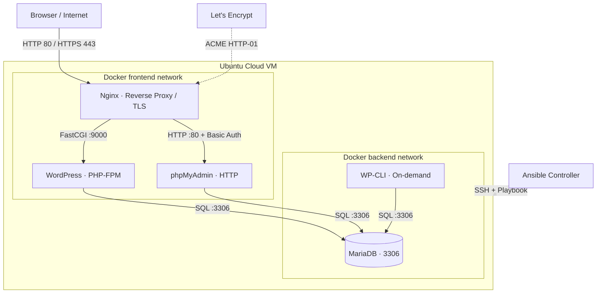

<div align="center">

# ☁️ Cloud-1 — Automated WordPress Infrastructure

**A reproducible, containerized WordPress stack deployed on an Ubuntu cloud server with Ansible and Docker Compose.**


**42 Paris · Cloud / DevOps · Team project**

</div>

---

## Overview

Cloud-1 explores **Infrastructure as Code (IaC)** by automating the configuration and deployment of a complete web application stack. Instead of installing and configuring each component manually, an Ansible playbook prepares an Ubuntu server, installs Docker, deploys the application, configures HTTPS, and initializes WordPress.

The focus is on **repeatability, modularity, persistence, service isolation, and secure configuration**.

## Architecture



**Separation of responsibilities**

| Component | Purpose | Exposure |
| --- | --- | --- |
| **Nginx** | Web server, HTTPS termination, FastCGI gateway, reverse proxy | Ports **80/443** published |
| **WordPress (PHP-FPM)** | Runs the WordPress application | Docker network only, port **9000** |
| **MariaDB** | Stores WordPress data | Docker backend network only, port **3306** |
| **phpMyAdmin** | Database administration | Accessed through Nginx under `/phpmyadmin/` |
| **WP-CLI** | Automates WordPress setup | On-demand container (`tools` profile) |

Docker named volumes preserve database and WordPress files independently of container lifecycles.

## Tech Stack

- **Infrastructure:** Ubuntu 22.04 LTS, SSH
- **Automation:** Ansible, roles, Ansible Vault
- **Container orchestration:** Docker Engine, Docker Compose v2
- **Web:** Nginx (Alpine), WordPress with PHP 8.3 FPM
- **Database:** MariaDB 11.8, phpMyAdmin
- **TLS:** Certbot, Let's Encrypt, ACME HTTP-01
- **Application initialization:** WP-CLI

## Features

- **One-command configuration and deployment** using an Ansible playbook.
- **Role-based automation** separating Docker installation, stack deployment, TLS, and WordPress setup.
- **Idempotent operations** to avoid unnecessary work on repeated executions.
- **Two Docker networks** to separate public-facing services from database communication.
- **Persistent volumes** for WordPress content and MariaDB data.
- **HTTPS** with HTTP-to-HTTPS redirection and TLS 1.2/1.3.
- **ACME webroot bootstrap** for obtaining a certificate on a new deployment.
- **Secrets management** using Ansible Vault and file-backed Docker Compose secrets.
- **Protected phpMyAdmin** with an additional Nginx Basic Authentication gate.
- **Nginx security rules** restricting access to sensitive paths and PHP execution in upload directories.
- **Automated WordPress installation** using an ephemeral WP-CLI container.

## Project Structure

```text
.
├── docker/
│   ├── docker-compose.yml
│   └── nginx/
│       ├── bootstrap.conf      # HTTP-only configuration for ACME bootstrap
│       └── default.conf        # HTTPS, WordPress routing, phpMyAdmin proxy
├── group_vars/
│   └── all/
│       └── vault.yml           # Ansible Vault-encrypted variables
├── roles/
│   ├── docker/tasks/main.yml   # Docker Engine / Compose installation
│   ├── stack/tasks/main.yml    # Compose files, secrets, Nginx, containers
│   ├── tls/tasks/main.yml      # Certbot, certificate, HTTPS activation
│   └── wordpress/tasks/main.yml # DB readiness and WP-CLI installation
├── inventory.ini
├── lab.yml                     # Main playbook
└── README.md
```

> File names and paths reflect the core project layout. Adapt the deployment configuration to your own infrastructure before running it.

## Deployment

### Prerequisites

- An **Ubuntu 22.04 LTS** server with SSH access and sufficient resources for the containers.
- A public IP address and a domain name pointing to it.
- Inbound access to **22 (SSH)**, **80 (HTTP)**, and **443 (HTTPS)**, as required by the deployment.
- Ansible installed on your **control machine**, including the `community.docker` collection.
- The Ansible Vault password and values for the application's required secrets.

### 1. Clone the repository

```bash
git clone <YOUR_REPOSITORY_URL>
cd cloud-1
```

### 2. Configure the target server and domain

Update `inventory.ini` with your **own** VM IP address and SSH username:

```ini
[wordpress_hosts]
YOUR_VM_IP ansible_user=root
```

Set the deployment domain and other site-specific settings to match your DNS records. The domain must resolve to the target server before the ACME HTTP-01 challenge can succeed.

> The current deployment was developed against an educational Ubuntu VM with root SSH access. Other SSH users may require privilege-escalation adjustments.

### 3. Prepare secrets

The playbook reads values from an **Ansible Vault-encrypted** file at `group_vars/all/vault.yml`. The required variable names include:

```yaml
vault_mariadb_root_password: "REPLACE_ME"
vault_mariadb_wordpress_password: "REPLACE_ME"
vault_pma_gate_user: "REPLACE_ME"
vault_pma_gate_password: "REPLACE_ME"
vault_letsencrypt_email: "REPLACE_ME"
vault_wp_admin_user: "REPLACE_ME"
vault_wp_admin_email: "REPLACE_ME"
vault_wp_admin_password: "REPLACE_ME"
```

**These values are illustrative only. Do not commit plaintext passwords.** Create or edit the encrypted file using `ansible-vault`, or provide your own secure secret-management workflow.

Install the required collection, if not already available:

```bash
ansible-galaxy collection install community.docker
```

### 4. Deploy

```bash
ansible-playbook -i inventory.ini lab.yml --ask-vault-pass
```

The playbook orchestrates the following stages:

1. **Docker role:** Configure the Docker APT repository and install Docker Engine / Compose.
2. **Certificate check:** Determine whether the TLS certificate already exists.
3. **Stack role:** Copy configuration, create secret files, prepare ACME paths, and start containers.
4. **TLS role:** Obtain a Let's Encrypt certificate (when needed) and enable the HTTPS Nginx configuration.
5. **WordPress role:** Wait for MariaDB, check whether WordPress is installed, and initialize it with WP-CLI if necessary.

**Why the HTTP bootstrap?** Nginx cannot load the final HTTPS configuration without certificate files. The temporary HTTP configuration allows Certbot's HTTP-01 challenge to run first; the HTTPS configuration is activated afterward. Port 80 remains available for redirects and future ACME challenges.

### 5. Verify

On the VM:

```bash
docker ps
docker compose -f /opt/cloud-1/docker-compose.yml ps
docker network ls
docker volume ls
```

From another machine, check the site's response:

```bash
curl -I https://YOUR_DOMAIN
curl -I http://YOUR_DOMAIN
```

The expected outcome is a working WordPress site over HTTPS and an HTTP-to-HTTPS redirect (except for ACME challenge requests).

Re-run the playbook to inspect **idempotency**: unchanged resources should report `ok` rather than unnecessary modifications.

## Security Design

| Area | Implementation |
| --- | --- |
| **Public exposure** | Nginx publishes HTTP/HTTPS; database and PHP-FPM ports are not published to the host. |
| **Network isolation** | `frontend` and `backend` Docker networks restrict direct service-to-service communication. |
| **Transport security** | Nginx terminates HTTPS using a Let's Encrypt certificate. |
| **Secrets at rest in the repository** | Ansible Vault encrypts sensitive variable values. |
| **Runtime secrets** | File-backed Compose secrets are mounted under `/run/secrets/` inside authorized containers. |
| **Administration** | phpMyAdmin is accessed via Nginx and protected with HTTP Basic Authentication. |
| **File access** | Selected Nginx rules reject sensitive paths and PHP requests under WordPress uploads. |
| **Filesystem access** | Selected mounts are read-only; host secret files are placed in a restricted directory. |

**Security note:** Local file-backed Docker Compose secrets are **not** Docker Swarm encrypted secrets. They remain plaintext files on the target VM. Nginx TLS protects browser-to-proxy traffic; internal Docker traffic is not automatically encrypted by TLS.

## Validation & Useful Commands

```bash
# List services and their published ports
docker ps

# Inspect frontend / backend membership
docker network inspect cloud-1_frontend
docker network inspect cloud-1_backend

# Inspect images and resource usage
docker images
docker ps --size
docker system df -v
docker stats --no-stream

# Validate active Nginx configuration
docker exec cloud-1-nginx-1 nginx -t

# Check HTTPS response and redirect
curl -I https://YOUR_DOMAIN
curl -I http://YOUR_DOMAIN
```

For an **external exposure test**, run a port scan only against infrastructure that you own or are authorized to test:

```bash
nmap -Pn -sT -p 22,80,443,3306,9000,8080 YOUR_VM_IP
```

Expected public TCP exposure for this project: **22, 80 and 443**. The MariaDB port **3306** and PHP-FPM port **9000** should not be publicly exposed.

## Scope & Limitations

This is an **educational infrastructure project**, not a claim of production readiness.

- VM creation and initial SSH/DNS setup are **external prerequisites**, not automated by the playbook.
- Named volumes survive container recreation, **not deletion of the underlying VM**. Backups are required for disaster recovery.
- The first deployment requires valid public DNS and a reachable HTTP port for certificate issuance.
- Automatic certificate renewal should be paired with an Nginx reload strategy so new certificates are picked up.
- Site-specific settings and hard-coded service names/paths may need adaptation for a different cloud provider or topology.

## Teamwork

Built as a **two-person 42 Paris project**, combining complementary work on:

- **Docker & application stack:** Compose services, container communication, persistence, application configuration, and local testing.
- **Cloud & automation:** Ubuntu VM, SSH access, Ansible roles, secret management, HTTPS integration, and deployment validation.

Both parts were integrated into a single deployment workflow and reviewed as one infrastructure system.

---

<div align="center">

**42 Paris · Cloud-1 · Infrastructure as Code**

</div>
